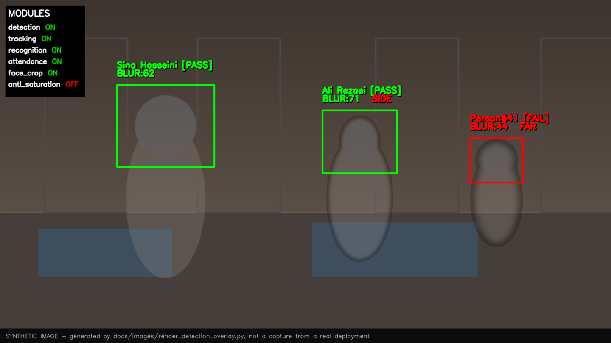
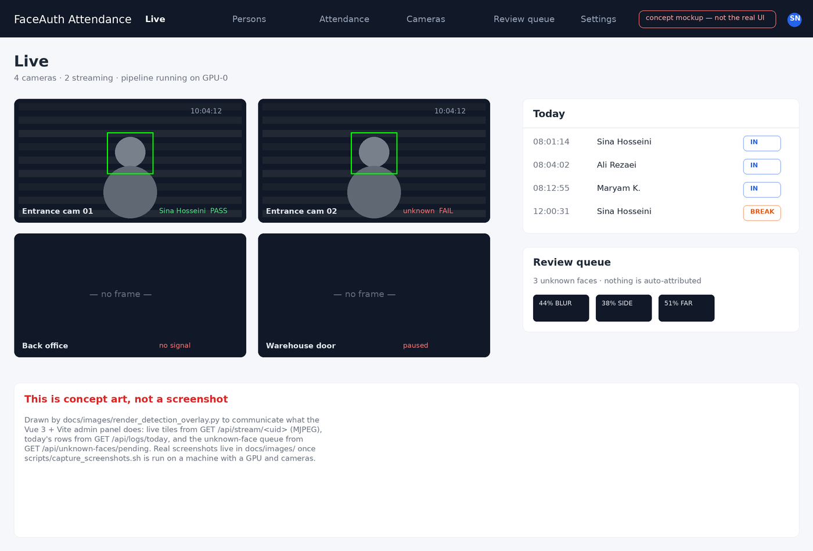
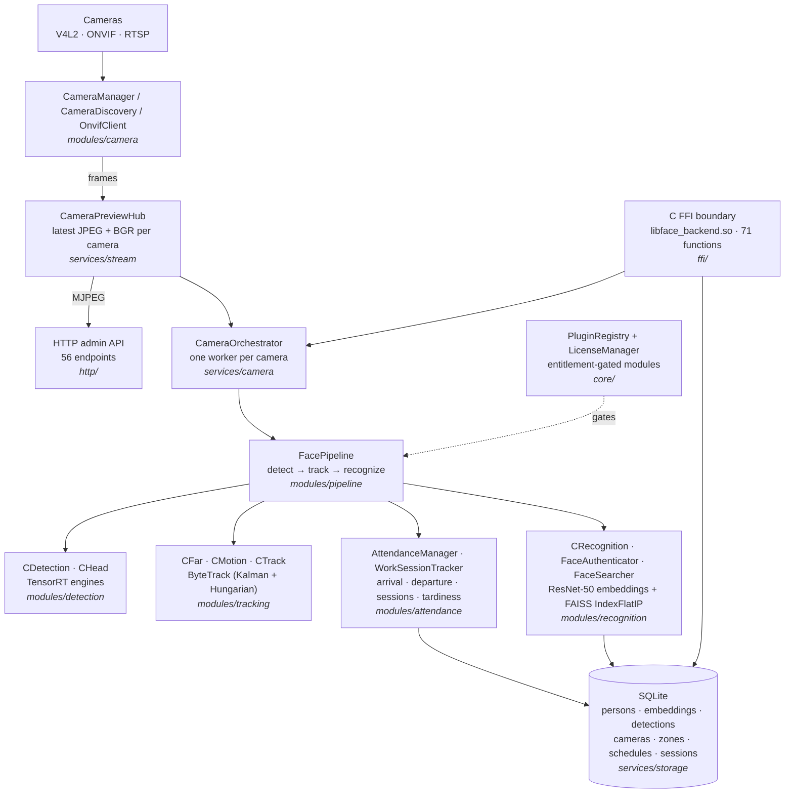

<div align="center">

# FaceAuth Attendance

**Real-time multi-camera face authentication & attendance backend**

C++20 · NVIDIA TensorRT · FAISS · ByteTrack · OpenCV/GStreamer · ONVIF/RTSP · SQLite · REST + C FFI

[](https://github.com/seyedmohammadsinahosseini/cpp-face-auth-attendance/actions/workflows/ci.yml)
[](LICENSE)
[](https://en.cppreference.com/w/cpp/20)
[](#requirements)
[](docs/BUILDING.md)

*Concept mockup of the operator dashboard — see [Screenshots](#screenshots) for what is real and what is a design sketch.*

</div>

---

## Table of contents

- [What this is](#what-this-is)
- [Screenshots](#screenshots)
- [Architecture at a glance](#architecture-at-a-glance)
- [A two-minute tour for reviewers](#a-two-minute-tour-for-reviewers)
- [Features](#features)
- [Technology stack](#technology-stack)
- [Quick start](#quick-start)
- [REST API](#rest-api)
- [C FFI / embedding the engine](#c-ffi--embedding-the-engine)
- [Project layout](#project-layout)
- [Testing, CI and code style](#testing-ci-and-code-style)
- [Privacy, ethics and responsible use](#privacy-ethics-and-responsible-use)
- [Security](#security)
- [Known limitations](#known-limitations)
- [Documentation](#documentation)
- [Roadmap](#roadmap)
- [License and citation](#license-and-citation)

---

## What this is

A headless **C++20 backend for face-based presence and attendance** on an LAN of IP cameras.
It discovers cameras (V4L2, ONVIF, RTSP), streams them through an OpenCV/GStreamer pipeline,
runs GPU-accelerated face/head detection with **TensorRT**, keeps identities stable across frames
with **ByteTrack**, recognises people with a **FAISS** nearest-neighbour index over face
embeddings, and writes **arrival/departure, work-session, tardiness and location** records into
SQLite — while exposing every part of it through a **REST admin API** (including live MJPEG
previews) and a **stable C ABI** so non-C++ clients can drive it.

This repository is published as an **engineering portfolio piece**: it is the code I would want to
review — layered, documented, dependency-pinned, honest about what is not finished, and with the
nasty parts (thread lifetimes, camera discovery, GPU tensor layout, biometric data handling)
explicitly handled instead of hidden.

| | |
|---|---|
| **Scale** | 12,881 lines of first-party C++20 in 87 files (excluding tests and the vendored HTTP header) |
| **Surface** | 56 REST endpoints, 71 C FFI functions, 14 SQLite tables + SQL migration files |
| **Concurrency** | Per-camera worker threads, bounded frame queues, preview hub, embedding queue |
| **Portability** | Linux only (V4L2, `ifaddrs`, `localtime_r`), NVIDIA GPU required for inference |
| **Not included** | Model weights, camera credentials, the operator UI (see [Known limitations](#known-limitations)) |

---

## Screenshots

The project is a **headless daemon** — there is no bundled GUI — so the honest visuals are a
diagram, a rendering of what the detector actually draws, and an API capture you can reproduce.

| | |
|---|---|
|  | **Architecture** — rendered from this repository's sources; the camera → pipeline → storage → API path with thread boundaries. |
|  | **Per-frame pipeline** — what happens to one frame, including the motion short-circuit that skips GPU inference when nothing moved. |
|  | **Detection overlay** — synthetic illustration of the boxes/IDs that `DetectionDrawer` / `RecognitionDrawer` composite onto a frame. *Drawn by the scripts in `docs/images/`, not a capture of real people.* |
|  | **Operator dashboard — concept mockup only.** A design sketch for the UI that consumes this API. It is **not** a screenshot of shipped software. |

Real captures from your hardware (the recommended thing to put here) take one command:

```bash
./scripts/capture_screenshots.sh http://localhost:8080 docs/images/captures
```

See [docs/SCREENSHOTS.md](docs/SCREENSHOTS.md).

---

## Architecture at a glance



Three design decisions worth calling out:

1. **A preview hub between capture and consumption.** Cameras publish frames into a bounded
   buffer; the MJPEG responder and the inference workers read from it. A slow or disconnected
   viewer can therefore never stall a camera thread, and inference back-pressure never blanks the
   live view.
2. **A single C ABI (`ffi/face_ffi.h`) as the seam.** Every HTTP handler goes through the same C
   functions an external host would use, so the API surface doubles as the integration test of the
   library boundary. No HTTP handler reaches into internals directly.
3. **Modules, not `if`s.** Detection/tracking/recognition/quality-gate/liveness/attendance are
   registered in `core/PluginRegistry` and enabled per camera, honouring the entitlement set from
   `LicenseManager` — so a deployment can run with only the modules it is allowed to run.

Details: [docs/ARCHITECTURE.md](docs/ARCHITECTURE.md) · [docs/SCHEMA.md](docs/SCHEMA.md)

---

## A two-minute tour for reviewers

If you have five minutes, these six files show the range of the project better than the README:

| # | File | Look at |
|---|------|---------|
| 1 | [`main.cpp`](main.cpp) | Wiring: config → DB → camera discovery → orchestrator → HTTP server, with signal-based shutdown and a headless mode when `$DISPLAY` is absent. |
| 2 | [`modules/camera/CameraDiscovery.cpp`](modules/camera/CameraDiscovery.cpp) | Raw UDP multicast WS-Discovery, SOAP probing, RTSP path scanning and local `/dev/video*` enumeration — networking without a library. |
| 3 | [`modules/camera/OnvifClient.cpp`](modules/camera/OnvifClient.cpp) | Hand-rolled WS-Security `PasswordDigest` (SHA-1 + Base64), media-profile negotiation, and PTZ over SOAP/XML built on `pugixml`. |
| 4 | [`modules/pipeline/FacePipeline.cpp`](modules/pipeline/FacePipeline.cpp) | The frame path: letterbox + normalise into GPU tensors, motion short-circuit, ByteTrack association, embedding queue hand-off. |
| 5 | [`modules/recognition/FaceSearcher.cpp`](modules/recognition/FaceSearcher.cpp) | FAISS `IndexFlatIP` over L2-normalised embeddings: cosine similarity, threshold decisions, index rebuild on enrolment. |
| 6 | [`http/http_server.cpp`](http/http_server.cpp) | The 56-endpoint REST layer: multipart face enrolment, MJPEG streaming, path-traversal defence on `/api/files`, and camera credential redaction. |

Supporting evidence of hygiene: [`.github/workflows/ci.yml`](.github/workflows/ci.yml),
[`tests/`](tests), [`scripts/check_repo_hygiene.py`](scripts/check_repo_hygiene.py),
[`.clang-format`](.clang-format), [SECURITY.md](SECURITY.md), [docs/PRIVACY.md](docs/PRIVACY.md).

---

## Features

**Cameras and networking**
- Local capture through V4L2 (`/dev/video*`) and network capture through RTSP.
- ONVIF WS-Discovery over UDP multicast with optional RTSP port/path deep-scan for non-ONVIF cameras.
- ONVIF device/media service clients, stream-profile negotiation and PTZ control.
- WS-Security `PasswordDigest` authentication for camera credentials (never stored in source).
- Per-camera profile control: resolution, FPS, encoding, transport (TCP/UDP).
- Live MJPEG preview per camera, served from the preview hub, addressable by numeric id or UID.

**Vision pipeline**
- TensorRT face detection (multi-scale keypoint head) and a separate head detector, with face/head
  association by IoU to reject false positives and count people the face model cannot see yet.
- Motion analysis with background subtraction, configurable blur/dilate and area thresholds, used
  to **skip expensive GPU inference on idle frames**.
- ByteTrack association (Kalman filter + Hungarian assignment) wrapped in first-party tracking
  modules, plus far-distance and side-profile gates.
- Quality gates before enrolment: blur (Laplacian variance), side-profile, far-distance.
- ResNet-50 embedding model + FAISS `IndexFlatIP` for 1:N recognition against reference vectors.
- Per-camera and per-module enable/disable with runtime reconfiguration through the API.

**Attendance and access control**
- Arrival/departure events keyed by `(person, track)`, with dedupe so a person walking around does
  not generate fifty arrivals.
- Work sessions with break intervals, daily summaries, timelines and tardiness lists.
- Per-person schedules (expected hours, grace minutes, work days) and access levels.
- Zones with required access levels, plus current-location reporting across cameras.
- Unknown-face review workflow: raw detections are persisted with crops and can be enrolled as a
  new person or merged into an existing one — the embeddings index is rebuilt afterwards.

**Platform**
- SQLite persistence: the binary creates tables idempotently and patches missing columns in code,
  while `migrations/*.sql` holds the same changes as a manual upgrade path (nothing auto-applies
  that directory — see [docs/SCHEMA.md](docs/SCHEMA.md#migration-policy)).
- REST API (JSON) with raw-body face enrolment, MJPEG previews and CORS for browser dashboards.
- C FFI shared library (`libface_backend.so`) exposing the pipeline, database, cameras, previews
  and attendance — usable from Python, C#, Dart/Flutter, Rust, etc.
- Entitlement-gated module loading (`core/license`) so a build can be restricted to licensed features.

---

## Technology stack

| Area | Technology | Why here |
|------|-----------|----------|
| Language | C++20 | Move semantics, `std::filesystem`, structured bindings; no exceptions across the FFI boundary. |
| Build | CMake ≥ 3.26 + Conan 2 | Reproducible native dependency graph; project-local recipes in `conan/`. |
| GPU inference | CUDA + TensorRT (FP16/INT8) | Engine files are hardware-specific, so they are built by the operator, not shipped. |
| Vision | OpenCV 4 (GStreamer, FFmpeg, V4L backends) | Capture, pre/post-processing, drawing. |
| Tracking | ByteTrack (first-party Conan recipe) | ID stability under occlusion without a re-ID network. |
| Retrieval | FAISS `IndexFlatIP` | Exact cosine search is fast enough at the size of a site's roster and removes a false-negative class. |
| Streaming | GStreamer / FFmpeg | RTSP transport handling and codec fallbacks. |
| Camera control | ONVIF over SOAP/XML + `pugixml` | Discovery, profiles, PTZ. |
| API | cpp-httplib (vendored in `third_party/`) | Single-header server, no runtime dependency chain. |
| JSON | nlohmann/json | Config, API payloads, FFI serialisation. |
| Storage | SQLite 3 | Single-file deployment; zero-ops for an on-prem site. |
| Logging | first-party `log-factory` recipe | Structured log entries with colour formatters for the console. |

---

## Quick start

Full, copy-pasteable instructions — including the Conan recipe bootstrap and the
TensorRT engine build — live in **[docs/BUILDING.md](docs/BUILDING.md)**. The short version:

```bash
# 1. system packages (Ubuntu 22.04 / 24.04)
sudo apt install -y build-essential cmake python3 python3-pip git libssl-dev libsqlite3-dev \
    libgstreamer1.0-dev libgstreamer-plugins-base1.0-dev \
    gstreamer1.0-plugins-good gstreamer1.0-plugins-bad gstreamer1.0-libav

# 2. dependencies + local recipes (CUDA/TensorRT must already be installed)
python3 -m pip install conan && conan profile detect
conan create conan/recipes/byte-track
conan create conan/recipes/log-factory
conan create conan/recipes/tensorrt-runtime
conan install . --output-folder=build --build=missing

# 3. build and run
cmake --preset conan-release && cmake --build build -j"$(nproc)"
cp core/config/config.example.json core/config/config.json   # then point it at your models
./build/faceauth            # full application: discovery + pipeline + API on :8080
./build/faceauth-admin      # API only, cameras added via POST /api/cameras
```

Two things are intentionally **not** in the repository, by design:

- **Model weights** — third-party artifacts with their own licenses; see [docs/MODELS.md](docs/MODELS.md).
- **`log-entry`** — a proprietary internal package; without it `conan install` cannot resolve the
  logging dependency. A stub recipe is described in [docs/BUILDING.md](docs/BUILDING.md#4-optional-internal-dependencies).

With those resolved, `cmake --build build` produces `libface_backend.so`, `faceauth` and
`faceauth-admin`. The dependency-free unit tests always build on plain Linux:
`cmake -S tests -B build/tests && cmake --build build/tests && ctest --test-dir build/tests`.

---

## REST API

The server listens on `0.0.0.0:8080`, speaks JSON, and sends CORS headers for browser clients.
**There is no authentication in this build — see [SECURITY.md](SECURITY.md) before exposing it.**

```bash
curl -s localhost:8080/api/health
# {"status":"ok"}

curl -s localhost:8080/api/dashboard/stats | python3 -m json.tool | head -12
# { "totalPersons": 128, "presentToday": 96, "activeDevices": 4, ... }

curl -s -X POST localhost:8080/api/persons -H 'Content-Type: application/json' \
     -d '{"name":"A. Student","code":"STU-042","accessLevel":2}'

# Enrolment: the raw image bytes *are* the body; the pipeline embeds them and
# stores the reference vector (512 float32) for this person.
curl -s -X POST localhost:8080/api/persons/42/face \
     --data-binary @/path/to/portrait.jpg        # Content-Type is ignored

curl -s "localhost:8080/api/attendance/summary?date=2026-10-07"
curl -s localhost:8080/api/cameras              # note: 'password' is never echoed back
```

Grouped summary — the complete reference with payloads is [docs/API.md](docs/API.md):

| Group | Endpoints |
|-------|-----------|
| Lifecycle | `POST /api/init`, `POST /api/cleanup`, `GET /api/health`, `GET /api/modules` |
| People | `GET/POST /api/persons`, `GET/PUT/DELETE /api/persons/{id}`, `PUT .../access-level`, `GET/PUT .../schedule`, `POST .../face`, `GET /api/groups`, `POST /api/groups`, `GET /api/embeddings/references` |
| Review queue | `GET /api/unknown-faces`, `DELETE /api/unknown-faces/{id}`, `POST .../enroll`, `POST .../merge`, `GET /api/events` |
| Cameras | `GET/POST /api/cameras`, `GET/DELETE /api/cameras/{id}`, `PUT .../active`, `PUT .../ai`, `GET .../stream` (MJPEG), `POST /api/cameras/discover`, `GET/PUT /api/cameras/{id}/modules[/{name}]`, UID-addressed equivalents |
| Attendance | `POST /api/attendance/arrival`, `POST /api/attendance/departure`, `GET /api/attendance/summary`, `GET /api/attendance/tardiness`, `GET /api/attendance/timeline`, `GET /api/attendance/current-location/{id}` |
| Access zones | `GET/POST /api/zones`, `GET/PUT/DELETE /api/zones/{id}`, `PUT /api/zones/{id}/access-level` |
| Dashboard / files | `GET /api/dashboard/stats`, `GET /api/dashboard/activity`, `GET /api/files/{path}`, `GET/PUT /api/settings`, `GET /api/settings-all` |

---

## C FFI / embedding the engine

`libface_backend.so` exports a C API (`ffi/face_ffi.h`, 71 functions). Every allocation returned to
the caller is a `malloc`'d C string freed with `face_free_string`, and errors are retrieved with
`face_last_error` — so the boundary is usable from any language with a C ABI without dragging C++
types across it.

```c
#include "ffi/face_ffi.h"

face_init("core/config/config.json", "attendance.db");

FacePipelineHandle p = face_pipeline_create();
char *detections = face_process_frame(p, jpeg_bytes, jpeg_len);   // JSON in, JSON out
printf("%s\n", detections);
face_free_string(detections);
face_pipeline_destroy(p);

FaceDatabaseHandle db = face_db_open("attendance.db");
char *persons = face_db_get_all_persons(db);
face_free_string(persons);
face_db_close(db);

face_cleanup();
```

The HTTP layer is built on exactly these functions, so anything you can do from the API you can do
from the library — and the shipped `python3`/`ctypes` snippet in
[docs/FFI.md](docs/FFI.md#using-it-from-python) shows the pattern for a non-C++ host.

---

## Project layout

```
.
├── CMakeLists.txt              # face_backend library + faceauth / faceauth-admin binaries
├── conanfile.txt               # pinned dependencies (Conan 2)
├── conan/recipes/              # first-party Conan recipes (byte-track, log-factory, tensorrt-runtime)
├── core/
│   ├── config/                 # JSON config loader (+ config.example.json; local config is ignored)
│   ├── crypto/                 # SHA-1 for ONVIF WS-Security digests
│   ├── license/                # entitlement file parsing
│   ├── models/                 # model notes + tensor-reorder helper for ONNX→TensorRT
│   ├── xml/                    # pugixml wrapper used by the ONVIF clients
│   ├── EventBus.{h,cpp}        # lightweight in-process event bus
│   ├── PluginRegistry.{h,cpp}  # module registration and entitlement gating
│   ├── SFace.h                 # detection/recognition result types
│   └── StaticModule.{h,cpp}    # built-in module base class
├── modules/
│   ├── attendance/             # AttendanceManager, WorkSessionTracker
│   ├── camera/                 # discovery, manager, streamer, ONVIF client/PTZ
│   ├── detection/              # TensorRT face + head detectors, face process step
│   ├── draw/                   # detection / recognition / HUD frame drawers
│   ├── pipeline/               # FacePipeline: per-frame orchestration
│   ├── recognition/            # authenticator, FAISS searcher, motion, location
│   └── tracking/               # ByteTrack adapters (far / motion / profile / track)
├── services/
│   ├── buffer/                 # bounded thread-safe frame queue
│   ├── camera/                 # CameraOrchestrator (one worker per camera)
│   ├── inference/              # TensorRT inference service
│   ├── storage/                # FaceDatabase (SQLite + migrations), StorageService
│   └── stream/                 # CameraPreviewHub
├── ffi/                        # C ABI: face_ffi.h / face_ffi.cpp
├── http/                       # REST + MJPEG server
├── migrations/                 # versioned SQL migrations
├── third_party/                # vendored header-only deps (isolated, excluded from style/lint)
├── tests/                      # dependency-free unit tests + CTest wiring
├── scripts/                    # format.sh, capture_screenshots.sh, check_repo_hygiene.py
└── docs/                       # architecture, API, building, configuration, models, privacy, …
```

---

## Testing, CI and code style

- **Unit tests** (`tests/`) cover the logic that can be tested honestly without a GPU: the SHA-1
  helper against RFC 3174 vectors and padding boundaries, and the bounded frame queue under a real
  producer/consumer race (order, capacity rejection, wraparound, no lost items). They are wired to
  CTest and also build standalone.
- **CI** ([`.github/workflows/ci.yml`](.github/workflows/ci.yml)) runs on every push/PR:
  *unit tests* on plain `ubuntu-latest` (no GPU needed), *repository hygiene*
  (`scripts/check_repo_hygiene.py` — no weights, no databases, no credentials, no `config.json`,
  docs links resolve, README sections present), and *formatting* (`clang-format --dry-run -Werror`).
  A CUDA/TensorRT build job is defined for `workflow_dispatch` so it can run on a self-hosted GPU
  runner without leaving a red ✗ on every commit.
- **Style** is fixed by [`.clang-format`](.clang-format) (LLVM base, 4-space indent, 100 columns,
  `SortIncludes: Never` and `BreakStringLiterals: false` because include order and SQL/SOAP string
  literals are load-bearing here) and [`.editorconfig`](.editorconfig).
  Run `./scripts/format.sh` before committing.
- **Vendored code is isolated** (`third_party/`, marked `linguist-vendored`) so the language
  statistics and the review surface stay honest.

Adding tests is the single highest-value contribution for anyone who clones this: the
`modules/*` layer is where the interesting bugs live, and it is the part that needs the most work
to become testable. See [CONTRIBUTING.md](CONTRIBUTING.md).

---

## Privacy, ethics and responsible use

This software processes **biometric data**, the most sensitive category of personal data there is
(and the one that cannot be rotated after a breach). The repository states its position explicitly
in **[docs/PRIVACY.md](docs/PRIVACY.md)**:

- Face crops and embeddings are private data: `crops/`, `*.db` and `*.jpg/png` are
  `.gitignore`d, and the repository contains **no** images of real people, no database and no
  camera credentials — verified in CI, not just promised.
- The HTTP API is unauthenticated by design in this build; the README and `SECURITY.md` say plainly
  that it must not be exposed beyond a trusted network, and that camera credentials are stored
  **plaintext in SQLite** (a known, documented gap — and the reason `/api/cameras` never echoes
  them back).
- Recognition runs only after a quality gate; low-confidence faces land in a human-review queue
  rather than being auto-attributed, because a wrong match in an attendance system has consequences
  for a real person.
- Running this on identifiable people requires a lawful basis: notice, consent or an explicit
  institutional policy, plus retention limits. It is a *presence/attendance* tool, not a tool for
  surveillance of uninvolved third parties, and I will not extend it in that direction.
- Face-recognition accuracy differs across demographic groups; any deployment should be measured
  on the population that will actually use it, and the enrolment/review loop here exists so that
  humans, not thresholds, make the final call.

Published for study and critique. If you use ideas from it, the license asks for one thing: keep the
notice.

---

## Security

Read [SECURITY.md](SECURITY.md) for the full threat model, and
[docs/SECURITY_AUDIT.md](docs/SECURITY_AUDIT.md) for what I checked in the code itself.
Short version of what is already handled:

| Concern | Handling |
|---------|----------|
| Camera passwords leaked by the API | `ffi/face_ffi.cpp` serialises `hasPassword` instead of `password`; credentials are write-only over HTTP. |
| Path traversal via `/api/files/{path}` | Resolved and confined to the configured crops directory; anything else is `403`/`404`. |
| Secrets in git history | No credentials, hostnames or IPs in source; CI fails if a `config.json`, `*.db`, `*.engine` or image file is committed. |
| ONVIF authentication | WS-Security `PasswordDigest` (per spec), credentials supplied by the operator at runtime — never hard-coded. |
| Stack/ROP hardening | `-fPIE`/`-fPIC` plus `-Wl,-z,noexecstack` on the shared library. |

And what is **not** handled, stated loudly: no authentication, no TLS, no rate limiting, plaintext
credential storage in SQLite, and a `license.json` whose `signature` field is parsed but **not
cryptographically verified**. Those are listed in [Known limitations](#known-limitations) and are
the first items on the roadmap.

---

## Known limitations

I would rather list these than have you find them:

- **Not runnable out of the box.** It needs CUDA + TensorRT, an NVIDIA GPU, the third-party model
  weights and the non-distributed `log-entry` package. There is no CPU-only fallback path.
- **No UI in this repository.** The frontend that drove this backend was a separate internal
  project; the dashboard image above is a concept sketch, and `GET /api/*` is the only interface.
- **No HTTP auth/TLS/rate limiting** — trusted-LAN software only, as shipped.
- **SQLite credentials are plaintext**; a real deployment needs encryption at rest or a secret store.
- **`license.json` is not signed** in a verifiable way (the signature field is inert), so the
  entitlement gate is a configuration mechanism, not a security boundary.
- **`/api/unknown-faces` returns full 512-float embeddings** for every queued face — correct but
  wasteful at scale; it needs pagination/projection.
- **`AttendanceManager`/`WorkSessionTracker` do not yet close dangling sessions** on day rollover
  (`TODO` in `modules/attendance/WorkSessionTracker.cpp`); the API/DB layer is ready for it.
- **`log-factory`/`tensorrt-runtime` recipes keep their upstream `project/` nesting**, which I did
  not want to churn without a GPU to rebuild against.
- **Test coverage is narrow** (two dependency-free modules). The pipeline, drawers and TensorRT
  adapters are covered only by manual runs on real hardware.

---

## Documentation

| Document | Contents |
|----------|----------|
| [docs/ARCHITECTURE.md](docs/ARCHITECTURE.md) | Threads and data flow, why the hub/orchestrator split, module registry lifecycle, extension points. |
| [docs/API.md](docs/API.md) | All 56 endpoints with methods, request/response payloads, status codes and the MJPEG streams. |
| [docs/FFI.md](docs/FFI.md) | The 71-function C ABI, memory-ownership rules, Python/`ctypes` example. |
| [docs/BUILDING.md](docs/BUILDING.md) | System packages, Conan recipes, engine conversion, troubleshooting, CI on a self-hosted runner. |
| [docs/CONFIGURATION.md](docs/CONFIGURATION.md) | Every key in `config.json`, defaults, and which ones are safe to change at runtime. |
| [docs/MODELS.md](docs/MODELS.md) | Required models, ONNX → TensorRT conversion, INT8 calibration, license caveats. |
| [docs/SCHEMA.md](docs/SCHEMA.md) | SQLite tables, indexes, migration policy. |
| [docs/PRIVACY.md](docs/PRIVACY.md) | Data inventory, retention, lawful-basis checklist. |
| [docs/SECURITY_AUDIT.md](docs/SECURITY_AUDIT.md) | Findings from reading my own code, with severity and what I changed. |
| [docs/SCREENSHOTS.md](docs/SCREENSHOTS.md) | How to capture real frames, previews and API output into `docs/images/`. |
| [CHANGELOG.md](CHANGELOG.md) | Release notes; this release documents the repository cleanup. |
| [CONTRIBUTING.md](CONTRIBUTING.md) | Style, test expectations, commit conventions. |

---

## Roadmap

Ordered by what would most improve the system, not by ease:

1. Token authentication + TLS, and encrypted credential storage (blocks real-world use today).
2. Liveness detection — the hook exists in `modules/pipeline` and is disabled by default.
3. Session reconciliation: close dangling work sessions and backfill missed departures.
4. ReID-assisted tracking so identity survives long occlusions and camera hand-offs.
5. Pluggable inference backends (ONNX Runtime / OpenVINO) so the project is not TensorRT-only.
6. Pagination + projection for the review queues, and an event-stream endpoint (SSE) instead of polling.
7. Reference web dashboard built against `docs/API.md`.
8. Docker/compose recipe with a CUDA base image, and integration tests on a self-hosted runner.

---

## License and citation

Released under the **MIT License** — see [LICENSE](LICENSE). Third-party libraries and the model
weights referenced in [docs/MODELS.md](docs/MODELS.md) keep their own terms and are not re-licensed
here. The `log-entry` package is proprietary and is not distributed.

If you cite this in coursework or research, use [`CITATION.cff`](CITATION.cff).

<div align="center">

**Seyed Mohammad Sina Hosseini** · [seyedmohammadsinahosseini.ir](https://seyedmohammadsinahosseini.ir)

Built as a self-directed systems-engineering project. Reviewed, documented and cleaned up for publication —
the honest limitations above are part of the submission.

</div>
