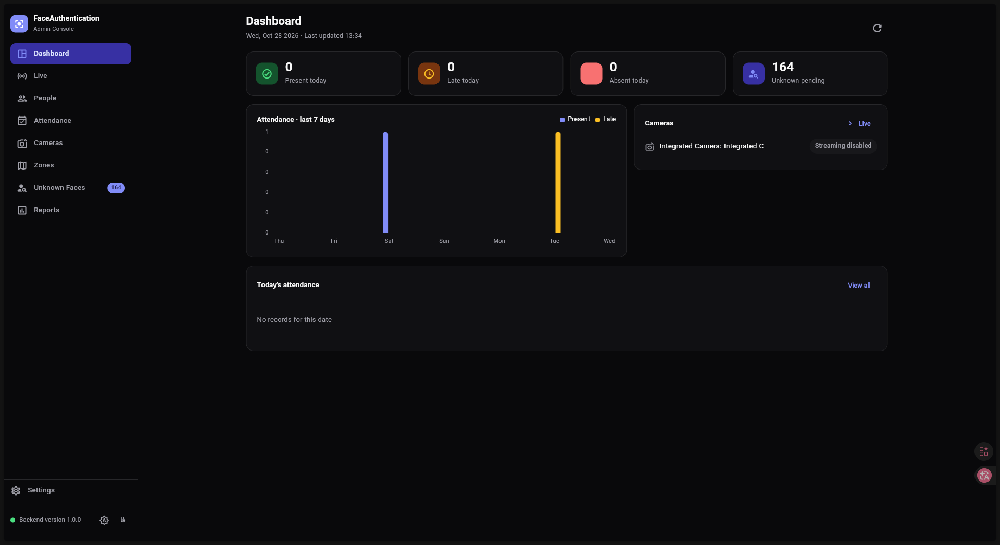
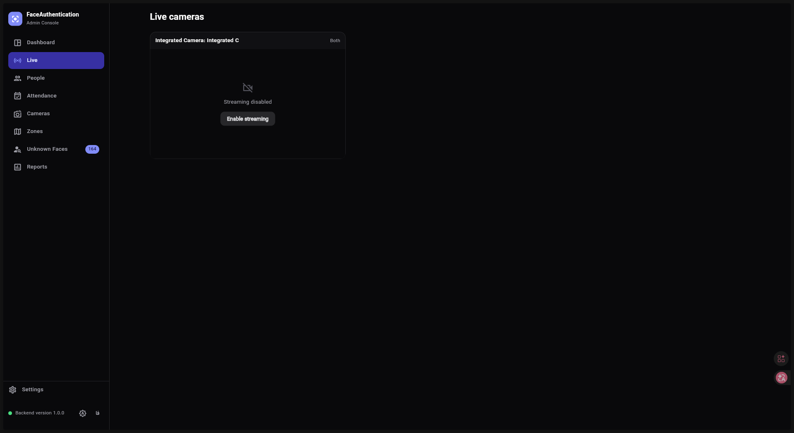
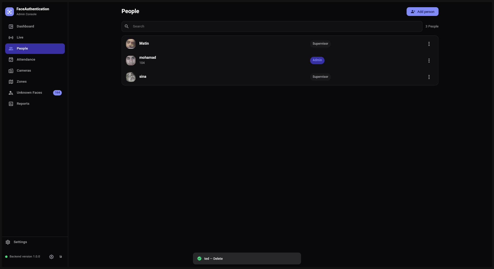
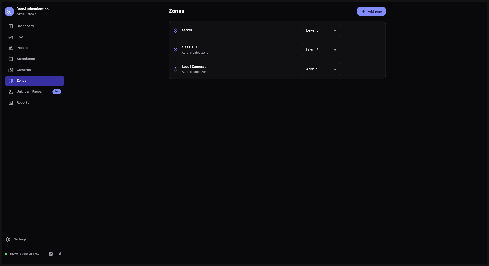
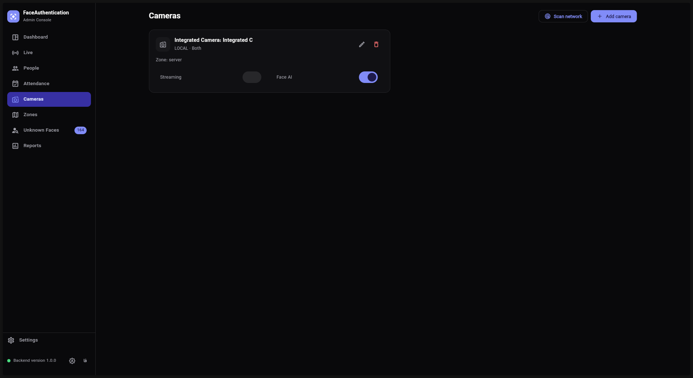
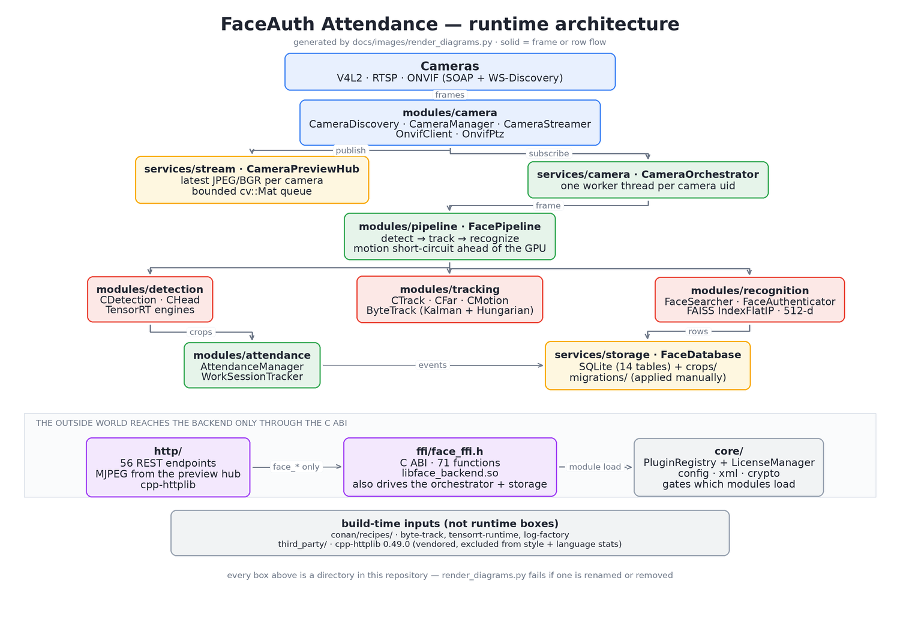
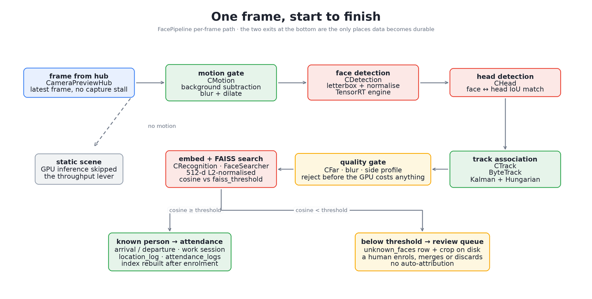
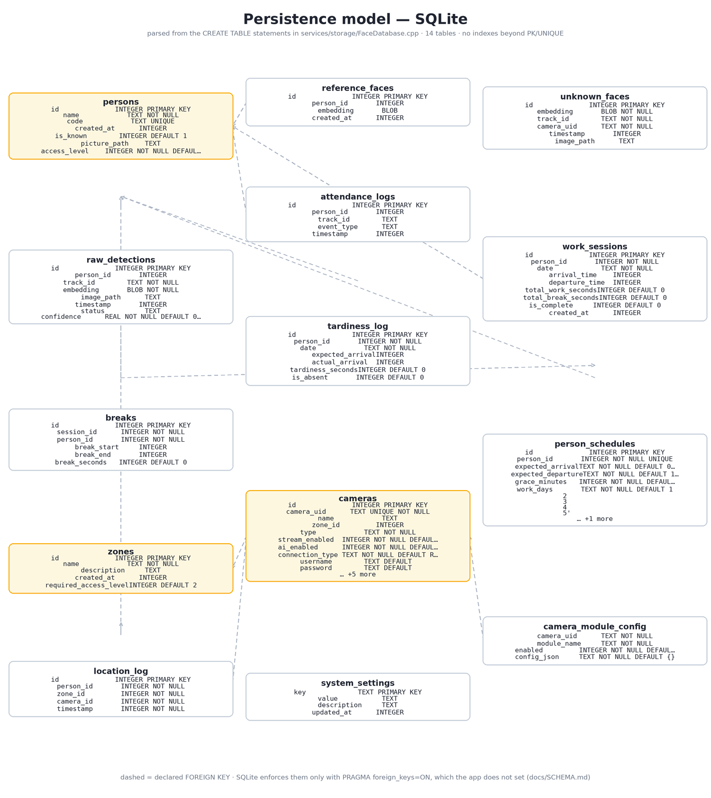

<div align="center">

# Aura

**Real-time face-authentication & attendance — a C++20/CUDA inference backend and a Flutter web console, in one repository.**

C++20 · NVIDIA TensorRT · FAISS · ByteTrack · OpenCV/GStreamer · ONVIF/RTSP · SQLite · REST + C FFI · Flutter Web (Riverpod)

[](https://github.com/seyedmohammadsinahosseini/Aura/actions/workflows/ci.yml)
[](LICENSE)
[](https://en.cppreference.com/w/cpp/20)
[](frontend/flutter/attendance_console)



</div>

---

Aura is a working attendance system built around faces: cameras are discovered and pulled, frames are
run through a TensorRT detection + recognition pipeline, recognised people become attendance, work-session
and tardiness records, and unrecognised faces land in a review queue where **a human** decides who they are.
It ships as two halves that talk over a documented HTTP API:

| | |
|---|---|
| `backend/` | C++20 service: V4L2/RTSP/ONVIF capture, GPU inference, tracking, recognition against a FAISS index, attendance logic, SQLite storage, a REST server whose preview channel serves polled JPEGs, and a C ABI for native embedders. |
| `frontend/flutter/attendance_console` | Flutter web console: dashboard, live camera wall, people, attendance, cameras, zones, review queue, reports, settings. |

Everything you need to judge it is in this README; the deep material is in [`docs/`](docs).

| | |
|---|---|
| **Backend** | 12,393 lines of first-party C++20 in 87 files (excluding the vendored `backend/http/httplib.h`, 20,724 lines) |
| **Console** | 7,994 lines of Dart in 25 files, plus widget tests |
| **Surface** | 40 HTTP routes in [`backend/http/http_server.cpp`](backend/http/http_server.cpp), 69 `face_*` functions in [`backend/ffi/face_ffi.h`](backend/ffi/face_ffi.h) |
| **Storage** | 14 SQLite tables + SQL migrations, face crops on disk |
| **Dependencies** | Conan 2: opencv 4.12.0, ffmpeg 4.4.6, faiss 1.12.0, sqlite3 3.53.0, gstreamer 1.28.1, nlohmann_json 3.11.3, pugixml 1.15, byte-track 1.0.0, tensorrt-runtime (local recipes in `backend/conan-custom/`) |
| **License** | MIT |

## Table of contents

- [What it looks like](#what-it-looks-like)
- [How a frame travels](#how-a-frame-travels)
- [Repository layout](#repository-layout)
- [Backend](#backend)
- [Console](#console)
- [Data, privacy and ethics](#data-privacy-and-ethics)
- [Run it](#run-it)
- [Verification: what CI checks and what you can re-run](#verification-what-ci-checks-and-what-you-can-re-run)
- [Known limitations](#known-limitations)
- [Roadmap](#roadmap)
- [Documentation](#documentation)
- [Author, license, citation](#author-license-citation)

## What it looks like

Three of the pictures below are captures of the console running against the backend on a development
machine (laptop webcam, test accounts); the last three are diagrams generated from this repository's
sources, so they cannot drift from the code.

| | |
|---|---|
|  | **Dashboard.** Present / late / absent / pending-review tiles, a 7-day attendance chart, per-camera status and today's rows, refreshed every 30 s from `GET /api/attendance/summary`, `GET /api/attendance/timeline` and `GET /api/cameras`. The zeros are honest: this session had no enrolled attendances yet, while 164 detections sat in the review queue waiting for a human. |
|  | **Live camera wall.** Each tile calls `GET /api/preview/{uid}/subscribe`, polls `GET /api/preview/{uid}/jpeg` at 4 fps with a cache-busting query parameter, renders with `Image.memory(gaplessPlayback: true)`, and unsubscribes on dispose. The backend publishes frames **only while a subscriber exists**, so opening a second viewer never doubles the encode cost — and a camera whose stream is off shows a disabled state with a one-click `Enable streaming` (`PUT /api/cameras/{uid}/active`) instead of a spinner. |
|  | **People.** A searchable table over `GET /api/persons` with add/edit, access level (`PUT /api/persons/{id}/access-level`) and delete. The profile screen adds a 24-hour attendance timeline, breaks, the schedule editor and the last-seen location. The portrait here is stored as a file (`PUT /api/persons/{id}/picture`, base64 inside a JSON body — the API stays single-content-type); it is *not* what recognises a person. |
|  | **Zones.** Physical areas with the access level a person must hold to be counted there (`GET /api/zones`, `PUT /api/zones/{id}/access-level`). Attendance is per-zone, which is why `location_log` exists as its own table rather than a column on the log. |
|  | **Cameras.** Cards with streaming and inference switches, a manual add/edit form, `POST /api/cameras/test` for a connection check before saving, and an ONVIF discovery scan (`POST /api/cameras/discover`, up to six minutes for a deep sweep) so a camera can be added without hand-writing an RTSP URL. Inference can be switched off per camera while the preview keeps running. |
|  | **Runtime architecture** — capture → hub → orchestrator → pipeline → storage/API, with the FFI seam and the module-registry gate. Drawn by [`docs/images/render_diagrams.py`](docs/images/render_diagrams.py), which fails if it names a directory that no longer exists. |
|  | **One frame, start to finish** — the gates, the two outcomes (recognise vs. queue for review), and where data becomes durable. |
|  | **Persistence model** — the 14 tables and their declared foreign keys, parsed out of the `CREATE TABLE` statements in [`backend/services/storage/FaceDatabase.cpp`](backend/services/storage/FaceDatabase.cpp). |

## How a frame travels

1. **Capture.** `modules/camera` pulls a stream (RTSP through GStreamer/FFmpeg, or V4L2), one worker
   thread per camera, and hands each decoded frame to `CameraPreviewHub`, which keeps the latest
   JPEG and BGR per camera in a bounded queue.
2. **Fan-out.** The hub feeds the orchestrator (`services/camera`), which owns the per-camera module
   configuration, and the preview endpoints, without either blocking capture.
3. **Detection.** `modules/detection` runs the TensorRT face detector (and, when enabled, a head
   detector used to disambiguate faces from face-shaped clutter).
4. **Tracking.** `modules/tracking` runs ByteTrack (Kalman + Hungarian assignment) so a person keeps
   one identity across frames instead of one detection per frame.
5. **Quality gates.** `modules/pipeline` can drop frames ahead of the GPU when nothing moved, and the
   `quality_gate` module rejects blur, side profiles and too-far faces *before* the expensive
   embedding step. Both default to off in the tracked config, because a tuned threshold is a
   deployment decision, not a library default.
6. **Recognition.** `modules/recognition` embeds each crop to 512-d, L2-normalises, and searches a
   FAISS `IndexFlatIP` of reference vectors; cosine ≥ `faiss_threshold` is a match.
7. **Two outcomes.** A match writes `attendance_logs` / `work_sessions` / `location_log` through
   `modules/attendance`. No match writes `unknown_faces` plus a crop on disk — a queue that only a
   person can drain, via *enrol*, *merge* or *discard*.
8. **Annotation.** `modules/draw` composites the boxes, `PASS`/`FAIL` and the quality flags onto the
   frame server-side, so the preview and the recorded frame are the same pixels.

## Repository layout

```
backend/                  the C++20 service
  core/                   config, crypto, licence/entitlement, plugin registry, XML (ONVIF parsing)
  modules/                camera · pipeline · detection · tracking · recognition · attendance · draw
  services/                storage (SQLite) · camera orchestration · stream · module control
  ffi/                    face_ffi.h — the C ABI for native embedders
  http/                   cpp-httplib server: REST routes + the preview hub
  migrations/             SQL, applied manually
  conan-custom/           local Conan recipes (byte-track, log-factory, tensorrt-runtime)
frontend/flutter/attendance_console/
  lib/features/           dashboard · live · people · attendance · cameras · zones · unknown · reports · settings
  lib/data/               ApiClient, models, repositories
  test/                   widget tests (run on any laptop, no GPU)
docs/                     architecture, API, schema, FFI, building, configuration, models, privacy, audit, screenshots
scripts/                  format, hygiene, build-frontend, capture_screenshots, purge_data
docker-compose.yml        backend on the host network + the console behind nginx
```

## Backend

- **Targets** ([`backend/CMakeLists.txt`](backend/CMakeLists.txt)): `face_backend` (shared library,
  also what the C ABI exposes), `FaceAuthentication` (standalone engine) and `admin_server`
  (the HTTP service the console talks to).
- **Runtime inputs**: `admin_server [configPath] [dbPath] [port]`. The default config is
  `core/config/config.json` resolved against the working directory; the committed copy is a
  development configuration, not a tuned one.
- **Modules are data, not `if` chains**: `core/plugins` keeps a registry, and per-camera overrides
  live in `camera_module_config`, read at worker start
  ([`backend/services/camera/CameraOrchestrator.cpp`](backend/services/camera/CameraOrchestrator.cpp)).
- **Concurrency**: one capture thread per camera, a bounded preview queue, an embedding queue with an
  explicit size (`pipeline.embedding_queue_max_size`), and a single mutex serialising HTTP handlers
  against the shared database handle. Backpressure is by dropping the oldest frame, never by growing
  memory.
- **C ABI** ([`backend/ffi/face_ffi.h`](backend/ffi/face_ffi.h)): 69 `face_*` functions with an
  opaque-handle convention, so a Qt/GTK/Python/Node client can embed the engine without C++ headers,
  exceptions or ABI churn. The web console deliberately does **not** use it: it is REST-only.
- **Machine learning**: three ONNX weights ship through Git LFS (see
  [.gitattributes](.gitattributes); ~187 MB, largest 174 MB). Run `git lfs install` before cloning.
  TensorRT `.engine` files are built per GPU on first start and are never committed.

### HTTP surface

| Group | Routes |
|---|---|
| Health & settings | `GET /api/health` (returns the version the console footer shows), `GET/PUT /api/settings/{key}`, `GET /api/modules` |
| People | `GET/POST /api/persons`, `GET/PUT/DELETE /api/persons/{id}`, `PUT .../access-level`, `GET/PUT .../picture` |
| Review queue | `GET /api/unknown-faces`, `GET .../{id}/image`, `POST .../{id}/enroll`, `POST .../{id}/merge`, `DELETE .../{id}` |
| Cameras | `GET /api/cameras`, `GET/PUT/DELETE /api/cameras/{uid}`, `PUT .../active`, `PUT .../configure`, `GET/PUT .../module/{name}`, `POST /api/cameras/discover`, `POST /api/cameras/test` |
| Live media | `GET /api/preview/{uid}/subscribe` → `.../jpeg` → `.../unsubscribe` — no MJPEG part; the console polls one JPEG per tick and the backend encodes only while subscribed |
| Attendance | `GET /api/attendance/summary`, `/timeline`, `/tardiness`, `/current-location/{personId}` — read-only: rows are written by the pipeline, never by the client |
| Zones & schedules | `GET/POST /api/zones`, `GET /api/zones/{id}`, `PUT .../access-level`, `PUT /api/schedules`, `GET /api/schedules/{id}` |

Every handler answers `application/json`, validates the body through one `parseBody()` helper (a
malformed body is `400`, not a `500`), and a catch-all `OPTIONS .*` covers the browser preflight —
40 resource routes plus that one, which is the number in the table at the top of this file. The list
above was generated from the registrations in
[`backend/http/http_server.cpp`](backend/http/http_server.cpp); that file is the contract.
[docs/API.md](docs/API.md) documents request and response bodies, but its route list was written for
the standalone backend and still names endpoints this build replaced.

## Console

Flutter web, `flutter run -d chrome` against a local backend; the same code builds into the static
bundle nginx serves in `docker-compose.yml`.

- **Stack**: `flutter_riverpod` for state and DI (no codegen), `go_router` for URL-addressable pages
  (deep links like `/people/17` work), `fl_chart` for the 7-day chart, `http` for transport,
  `shared_preferences` to persist the backend URL, theme and locale, `file_picker` for portraits.
- **Locale**: Persian (`fa`) first with full RTL, English second — the strings live in one file,
  [`lib/core/app_strings.dart`](frontend/flutter/attendance_console/lib/core/app_strings.dart), and
  dates are shown in the Jalali calendar (`shamsi_date`) while the API keeps Gregorian `YYYY-MM-DD`.
- **Data flow**: pages never call `http` directly; they watch Riverpod providers over
  [`lib/data/repositories.dart`](frontend/flutter/attendance_console/lib/data/repositories.dart), so
  the loading / empty / error states are rendered by one `AsyncGate` widget rather than by each page
  improvising. The server URL defaults to `http://localhost:8080` in debug and to same-origin `/api`
  in release, which is why the container needs no configuration.
- **Live view**: see the preview polling contract above — the client owns subscribe/unsubscribe, and
  `pause()` on a hidden page keeps the server-side subscription alive so returning is instant.
- **Tests**: [`test/`](frontend/flutter/attendance_console/test) holds widget tests that run against
  a stubbed `ApiClient`, so the UI is covered on a machine with no GPU and no cameras.

## Data, privacy and ethics

- Stored: enrolment embeddings (512-d vectors), reference portraits, detection crops, attendance and
  session rows, zone membership. Not stored: raw video. The system keeps evidence, not footage.
- Nothing is auto-attributed. A below-threshold face becomes a row in a queue; enrolling it is a
  human action, and `POST /api/unknown-faces/{id}/enroll` refuses an empty name (`400`) before it
  writes the person and triggers `rebuildIndex()`.
- The licence file's `signature` field is parsed but not verified — entitlement gating, not a
  security boundary. Stated plainly in [docs/CONFIGURATION.md](docs/CONFIGURATION.md).
- There is no retention job in the backend on purpose; [`scripts/purge_data.sh`](scripts/purge_data.sh)
  is the operator-side tool (timestamped backup, before/after row counts, orphaned-crop cleanup).
- [docs/PRIVACY.md](docs/PRIVACY.md) covers what a real deployment must add: a lawful basis, signage,
  a retention window, and an access-level review of who may read the queue.
- The people shown in the captures above are the author and test accounts; the faces in
  `docs/images/captures/03-people.png` are deliberately the only biometric material in this repository.

## Run it

**Everything, in Docker** (the backend needs the host network for camera discovery; the console is
served by nginx and proxies `/api/`):

```bash
git lfs install
git clone https://github.com/seyedmohammadsinahosseini/Aura.git && cd Aura
make up            # build-frontend → docker compose up --build
# console: http://localhost:3000   backend: http://localhost:8080/api/health
```

**Backend natively** (Linux, NVIDIA GPU, CUDA + TensorRT):

```bash
python3 -m pip install conan
conan profile detect --exist-ok
for r in byte-track log-factory tensorrt-runtime; do conan create backend/conan-custom/$r; done
conan install backend --output-folder=backend/build --build=missing
cmake -S backend -B backend/build -DCMAKE_TOOLCHAIN_FILE=backend/build/conan_toolchain.cmake
cmake --build backend/build -j"$(nproc)"
./backend/build/admin_server backend/core/config/config.json backend/attendance.db 8080
```

**Console natively**:

```bash
cd frontend/flutter/attendance_console
flutter pub get && flutter run -d chrome     # talks to http://localhost:8080 in debug
```

Full prerequisites, model handling and troubleshooting: [docs/BUILDING.md](docs/BUILDING.md).

## Verification: what CI checks and what you can re-run

CI ([.github/workflows/ci.yml](.github/workflows/ci.yml)) runs three jobs that need no GPU:

| Job | Command | Why it earns its place |
|---|---|---|
| Console | `flutter pub get && flutter test` | The UI is testable without the backend, because `ApiClient` is injectable. |
| Hygiene | `python3 scripts/check_repo_hygiene.py` | 8 checks: no databases/backups/keys committed, required files present, README shape, every capture is actually shown, every relative link and anchor resolves, no secrets or concrete LAN hosts in source, the console manifest declares what it imports, and the backend's CMake targets exist. |
| Style | `./scripts/format.sh --stats` | Reports how far the tree is from `clang-format` 23.1.3 (`71` of 87 files today). Advisory on purpose: this snapshot predates a formatting sweep, so the reformat is its own commit instead of noise inside a feature diff. |

`render_diagrams.py --check` runs as a step of the hygiene job, and a fourth job (`gpu-build`) is
`workflow_dispatch`-only because it needs a self-hosted runner with CUDA, TensorRT and the LFS
weights. That is written down rather than hidden.

## Known limitations

I would rather list these than have you find them:

- **No HTTP auth, TLS or rate limiting.** `admin_server` is a trusted-LAN component; putting it behind
  a reverse proxy is currently the answer, not the design.
- **Camera passwords are returned by `GET /api/cameras`.** They are also stored in plaintext in
  SQLite. Both are wrong and both are [documented with a plan](docs/SECURITY_AUDIT.md); the API
  response is the one that would need a client change, which is why it has not been done silently.
- **No automated backend tests.** The console has widget tests; the C++ side has none, and its logic
  that is genuinely unit-testable (schedule arithmetic, cosine thresholds, migration ordering) is not
  covered. Coverage is the honest weak spot of this repository.
- **`GET /api/unknown-faces` is unpaginated and returns embeddings** for every queued face — correct,
  and wasteful once the queue is long.
- **Work sessions are not closed on day rollover** (`TODO` in
  [`backend/modules/attendance/WorkSessionTracker.cpp`](backend/modules/attendance/WorkSessionTracker.cpp));
  the schema and API are ready for it.
- **`PRAGMA foreign_keys` is not enabled and there are no secondary indexes**, so declared FKs are
  documentation and a big table scan is what runs. Both are called out in
  [docs/SCHEMA.md](docs/SCHEMA.md).
- **Linux + NVIDIA only.** TensorRT engines are machine-specific, so there is no CPU fallback path.
- **The backend is single-process** and serialises HTTP behind one mutex — fine for a site-sized
  deployment, not for a multi-tenant service.
- **Docs still carry some pre-monorepo wording** where they say `services/…` instead of
  `backend/services/…`; links have been repointed, prose is being swept as files move.

## Roadmap

Ordered by what would make this wrong in production, not by what would be fun:

1. **Authenticate the API** — a bearer token plus TLS termination at the nginx that already fronts
   the console, so `0.0.0.0:8080` stops meaning "anyone on the LAN".
2. **Stop returning camera passwords** — `GET /api/cameras` should emit `hasPassword: bool` and keep
   the value write-only, as the standalone backend already does (finding 1.2 in
   [docs/SECURITY_AUDIT.md](docs/SECURITY_AUDIT.md)).
3. **Unit tests for the C++ logic that needs no GPU** — schedule arithmetic, cosine thresholding,
   migration ordering — wired into CTest, then into CI next to the console tests.
4. **Close dangling work sessions on day rollover**, with a test for the midnight case.
5. **Paginate and project `unknown_faces`** (drop the embeddings from the list view), and enable
   `PRAGMA foreign_keys` with a migration that proves the data tolerates it.
6. **One mechanical `./scripts/format.sh` commit**, after which the style job can stop being advisory.

## Documentation

| Document | What is in it |
|---|---|
| [docs/ARCHITECTURE.md](docs/ARCHITECTURE.md) | Layers, thread model, the plugin registry, why a C ABI boundary exists |
| [docs/API.md](docs/API.md) | Every route with payloads, status codes and the failure modes that are gaps rather than features |
| [docs/SCHEMA.md](docs/SCHEMA.md) | The 14 tables, missing indexes, unenforced foreign keys, migration policy |
| [docs/FFI.md](docs/FFI.md) | All 69 `face_*` functions and the handle/lifetime conventions |
| [docs/BUILDING.md](docs/BUILDING.md) | Conan + CMake, engine build, a systemd unit, Docker, troubleshooting |
| [docs/CONFIGURATION.md](docs/CONFIGURATION.md) | Every JSON key, which ones are inert, how config reloads |
| [docs/MODELS.md](docs/MODELS.md) | ONNX → TensorRT conversion, the calibrations, LFS handling |
| [docs/PRIVACY.md](docs/PRIVACY.md) | What is stored, what is never stored, operator duties |
| [docs/SECURITY_AUDIT.md](docs/SECURITY_AUDIT.md) | A self-audit with finding IDs, severity and status — including what is still open |
| [docs/SCREENSHOTS.md](docs/SCREENSHOTS.md) | What each image is, how it was made, and how to capture your own |
| [CONTRIBUTING.md](CONTRIBUTING.md) · [SECURITY.md](SECURITY.md) · [CHANGELOG.md](CHANGELOG.md) | How to change this code, how to report a problem, what changed |

## Author, license, citation

Seyed Mohammad Sina Hosseini — [seyedmohammadsinahosseini.ir](https://seyedmohammadsinahosseini.ir) ·
[seyedmohammadsinahosseini/cpp-face-auth-attendance](https://github.com/seyedmohammadsinahosseini/cpp-face-auth-attendance)
(the backend-only repository this monorepo grew from)

Released under the [MIT License](LICENSE). If you cite this software, use
[CITATION.cff](CITATION.cff).
